```{=typst}
// Una tabla partida entre dos páginas pierde su encabezado: se mantienen enteras.
#show table: it => block(breakable: false, it)
#v(6pt)
#block(width: 100%, fill: cip-suave, stroke: (left: 3pt + cip-azul), inset: 12pt, radius: (right: 4pt))[
  #text(size: 11pt)[
    Esta guía acompaña la presentación del taller, paso por paso. Cada tarjeta azul es lo que
    escribes en Mini-Me: cópiala tal cual, envíala y *espera a que termine* antes de enviar la
    siguiente.
  ]
]
#v(4pt)
```

# Qué vamos a lograr hoy

Partimos de un dataset de campo con errores y terminamos con un análisis estadístico, siempre
revisando lo que hace la IA.

| Paso | Qué haces |
|---|---|
| 1 · Crear | Tu proyecto en Mini-Me |
| 2 · Cargar | Un dataset de campo |
| 3 · Diagnosticar | Errores e inconsistencias |
| 4 · Limpiar | Y obtener un informe |
| 5 · Analizar | Con un ANOVA de rendimiento |

**Dataset de trabajo:** `mejoramiento_dirty.csv`, un ensayo de 30 genotipos de papa en 3 localidades
de Huancavelica y Junín, con 274 filas y 33 variables.

# Antes de empezar

```{=typst}
#prueba[
  Revisa que tengas las tres cosas:

  - *Mini-Me Desktop* instalado y con la sesión iniciada.
  - La *carpeta Taller Mini-me* en tu Escritorio, con `mejoramiento_dirty.csv` y la carpeta
    `datasets`.
  - Esta guía, impresa o en PDF.
]

#ojo[
  Trabaja siempre desde la carpeta del *Escritorio*. En las laptops institucionales, las
  carpetas en `C:\` pueden impedir que guardes archivos ("read-only" o "no permission").
]
```

# Paso 1 · Conoce la pantalla de Mini-Me

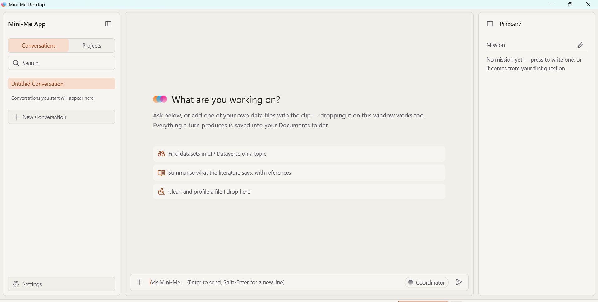{width=100% fig-alt="Pantalla inicial de Mini-Me Desktop"}

| Zona | Qué hay |
|---|---|
| Izquierda | Conversations y Projects |
| Centro | La conversación. Escribes abajo; Enter envía |
| Derecha | Pinboard, con la Mission del trabajo |
| Atajos | Dataverse, literatura y **Clean and profile a file**, el que usaremos |

: {tbl-colwidths="[32,68]"}

Todo lo que Mini-Me produce se guarda en tu carpeta **Documentos**.

# Paso 2 · Crea el proyecto Taller_Mini-me

1. Haz clic en la pestaña **Projects**.
2. Haz clic en **+ New Project**.
3. Escribe **Taller_Mini-me** y pulsa **Create**.
4. Se abre una conversación nueva: **ahí haremos todo**.

::: {layout="[[62,38]]"}
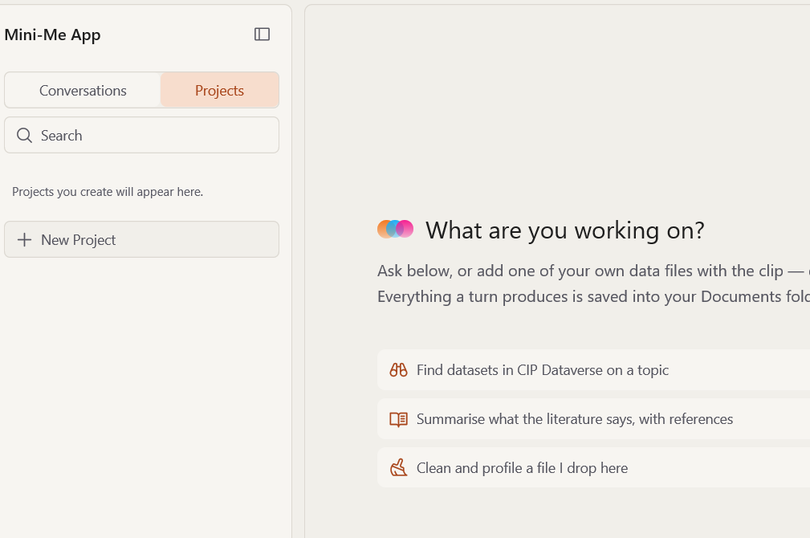{fig-alt="Pestaña Projects y botón New Project"}

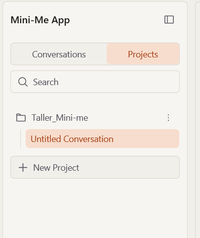{fig-alt="Proyecto Taller_Mini-me creado"}
:::

# Pasos 3 y 4 · Prueba y carga el archivo

## 3 · Prueba

```{=typst}
#prompt("Escribe en Mini-Me")[hola]
```

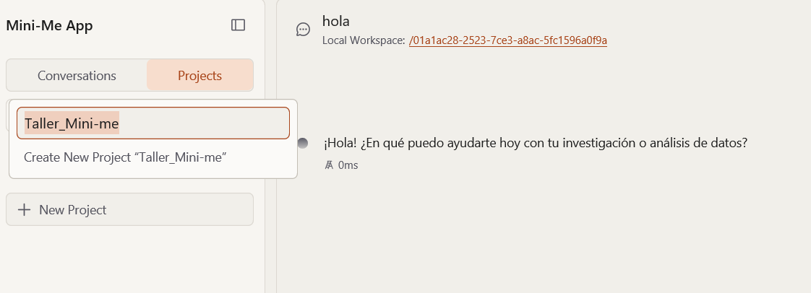{width=100% fig-alt="Primera respuesta de Mini-Me"}

## 4 · Carga el archivo

1. Haz clic en **+** en la barra de mensajes, o arrastra el archivo.
2. Abre **Escritorio › Taller Mini-me**.
3. Elige **mejoramiento_dirty.csv** y pulsa **Open**.

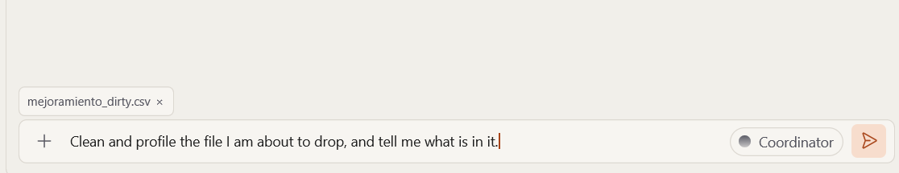{width=100% fig-alt="Archivo adjuntado en la barra de mensajes"}

```{=typst}
#nota[
  #set par(justify: false)
  Cada conversación trabaja en su propia carpeta: \
  `C:\Users\«tu usuario»\Documents\Mini-Me\Taller_Mini-me\«código de la conversación»`
]
```

# Paso 5 · Revisa y aprueba los comandos

Cuando Mini-Me necesita ejecutar código en tu computadora, te muestra una tarjeta **RUN THIS ON
YOUR MACHINE** y espera tu respuesta.

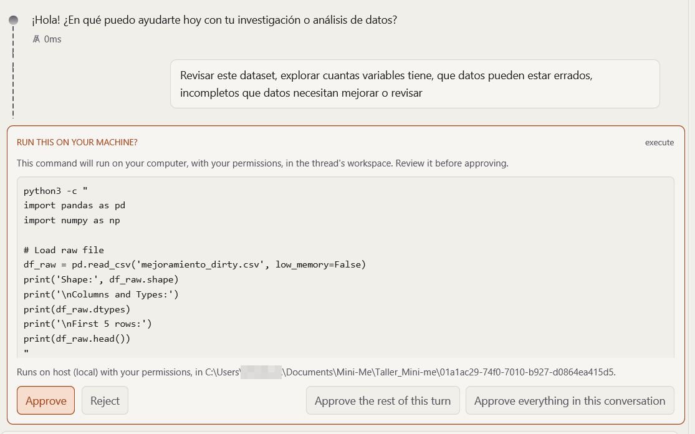{width=100% fig-alt="Solicitud RUN THIS ON YOUR MACHINE"}

| Botón | Qué hace |
|---|---|
| **Approve** | Ejecuta solo este comando |
| **Reject** | No lo ejecuta |
| **Approve the rest of this turn** | Aprueba los comandos de esta respuesta |
| **Approve everything…** | Aprueba toda la conversación (solo con datos de prueba) |

: {tbl-colwidths="[32,68]"}

```{=typst}
#ojo[
  *Buena práctica:* lee el código antes de aprobar. Si no lo entiendes, pregúntale a Mini-Me qué
  hace.
]
```

# Paso 6 · Cinco instrucciones, en orden

Las cinco instrucciones llevan el archivo de sucio a curado. Envía **una a la vez** y espera a que
termine antes de enviar la siguiente.

| # | Instrucción | Qué obtienes |
|---|---|---|
| 01 | Estructura | Filas, variables y tipos |
| 02 | Diagnóstico | Faltantes, duplicados e imposibles |
| 03 | Recomendaciones | Cómo corregir cada problema |
| 04 | Reporte | Informe técnico en .md y PDF |
| 05 | Limpieza | Dataset curado en un archivo nuevo |

## 01 · Estructura

```{=typst}
#prompt("Escribe en Mini-Me · 01")[
  Revisa la estructura y las dimensiones de este dataset: cuántas filas y variables tiene, de qué
  tipo es cada variable y qué representa.
]
```

**Qué deberías encontrar:** 274 filas y 33 variables.

## 02 · Diagnóstico

```{=typst}
#prompt("Escribe en Mini-Me · 02")[
  Revisa las inconsistencias y los datos incompletos: valores faltantes, duplicados, valores
  imposibles y errores de unidades.
]
```

**Qué deberías encontrar:** 7 parcelas duplicadas y entre 3 % y 15 % de datos faltantes según la
variable, además de:

| Problema | Ejemplo |
|---|---|
| Diseño | `rep = 0`, `rep = 4` (solo hay 3 repeticiones) y 9 parcelas sin repetición |
| Ubicación | Altitudes de 10 551 a 13 346 "msnm" (en realidad pies) y localidades escritas de varias formas |
| Valores imposibles | Negativos (`ntp = −50`) y `ntp = 375` en una parcela de 10 tubérculos sembrados |
| Escala | Rendimientos ×1000 (kg/ha registrados como t/ha) y pesos en libras |
| Nombres | `añil papa` en minúsculas y códigos con espacios crean genotipos "falsos" |

: {tbl-colwidths="[32,68]"}

```{=typst}
#nota[
  Estas cifras salen del registro de errores sembrados en el dataset. El informe de Mini-Me
  puede contarlas de forma ligeramente distinta: lo importante es que sepas de dónde sale cada una.
]
```

## 03 · Recomendaciones

```{=typst}
#prompt("Escribe en Mini-Me · 03")[
  Dame recomendaciones de limpieza y estandarización de datos para cada problema encontrado.
]
```

Un ejemplo de lo que debería recomendar:

- Unificar las tres localidades: **Ccasapata** (3766 msnm), **Ccollpaccasa** (4068) y **La
  Victoria** (3216).
- Pasar a metros las altitudes registradas en pies.
- Volver a kg y t/ha los pesos en libras y los rendimientos en kg/ha.

## 04 · Reporte

```{=typst}
#prompt("Escribe en Mini-Me · 04")[
  Genera un reporte técnico con el diagnóstico y el plan de limpieza.
]
```

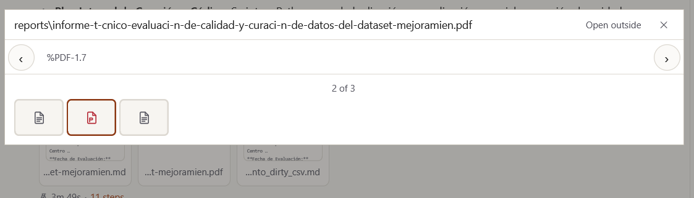{width=100% fig-alt="Vista previa del informe generado"}

## 05 · Limpieza

```{=typst}
#prompt("Escribe en Mini-Me · 05")[
  Procede con la estandarización y limpieza de los datos, siguiendo las recomendaciones. Guarda el
  dataset curado como un archivo nuevo y no modifiques el original.
]

#prueba[
  *Resultado esperado*

  - *267* parcelas únicas, sin duplicados.
  - *3 localidades* estandarizadas, con su altitud en metros.
  - Unidades corregidas y variables derivadas recalculadas.
  - El archivo original *queda intacto*.
]
```

# Dónde quedan tus archivos

Todo queda en **Documentos › Mini-Me › Taller_Mini-me ›** (carpeta con el código de la
conversación).

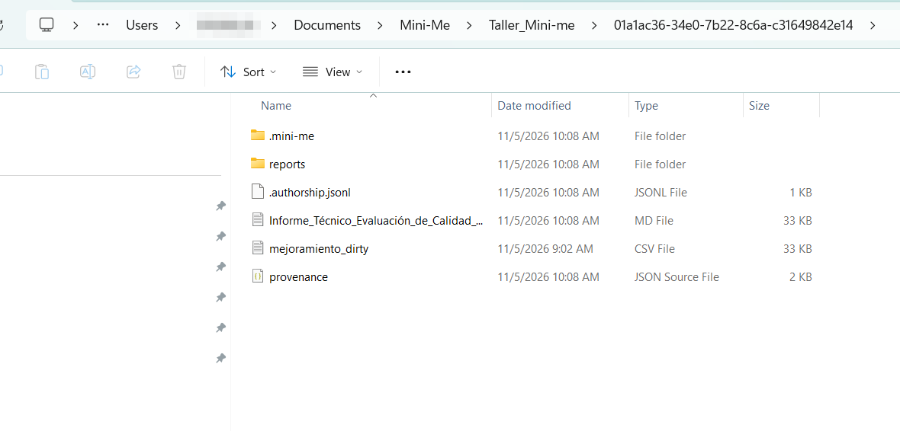{width=100% fig-alt="Carpeta de resultados del proyecto"}

| Archivo | Qué es |
|---|---|
| `mejoramiento_dirty.csv` | Copia del original |
| Informe `.md` y carpeta `reports` | El informe técnico en PDF |
| `provenance.json` y `.authorship.jsonl` | El registro de lo que se hizo (trazabilidad) |

: {tbl-colwidths="[32,68]"}

# Pasos 06 y 07 · ¿Qué genotipo rinde más y qué análisis hacer?

```{=typst}
#prompt("Escribe en Mini-Me · 06")[
  Con el dataset curado, propón qué análisis se pueden hacer. ¿Cuál de los genotipos evaluados
  rinde más, en promedio y en cada localidad?
]
```

**Qué deberías encontrar** (promedio de las tres localidades, calculado sobre el dataset limpio):

| Puesto | Genotipo | Variedad | ttya medio (t/ha) |
|---|---|---|---|
| 1 | CIP701675 | Tarmeña | 31.7 |
| 2 | CIP703168 | Puca Pishgush | 31.0 |
| 3 | CIP705543 | Yana Warmi | 30.0 |
| 4 | CIP704327 | Color Unckuna | 28.2 |
| 5 | CIP702363 | Socco Huaccoto | 26.7 |

```{=typst}
#prompt("Escribe en Mini-Me · 07")[
  Dame recomendaciones de análisis estadístico para este ensayo.
]
```

Los análisis que suele recomendar:

1. **ANOVA combinado y comparación de medias** (el que hacemos hoy).
2. Estabilidad: AMMI o GGE biplot.
3. Modelos mixtos y BLUPs.
4. Correlación entre caracteres.
5. Índice de selección multicarácter.

# Paso 8 · ANOVA para rendimiento ajustado (ttya)

```{=typst}
#prompt("Escribe en Mini-Me · 08")[
  Realiza un ANOVA combinado para ttya con el dataset curado: genotipo (instn), localidad
  (locality) y su interacción, con la repetición dentro de cada localidad como bloque. Incluye
  Tukey HSD y un gráfico del rendimiento de cada genotipo en las tres localidades.
]
```

**Qué deberías encontrar** (calculado sobre el dataset limpio):

| Fuente | p | Qué dice |
|---|---|---|
| Localidad | < 0.001 | La Victoria rinde el doble que Ccasapata |
| Genotipo | < 0.001 | Hay genotipos mejores que otros |
| Genotipo × localidad | < 0.001 | El ranking cambia según la localidad |
| Repetición (dentro de localidad) | 0.31 | Los bloques no difieren |

: {tbl-colwidths="[32,14,54]"}

| Resultado | Cómo leerlo |
|---|---|
| p (genotipo) < 0.05 | Hay diferencias entre genotipos |
| p (interacción) < 0.05 | El mejor genotipo en un sitio no es el mejor en todos |
| Tukey | Misma letra = no difieren |

: {tbl-colwidths="[32,68]"}

```{=typst}
#ojo[
  Socco Huaccoto (CIP702363) es 2.º en Ccollpaccasa y 13.º en La Victoria. ¿Lo recomendarías para
  las tres localidades?
]

#nota[
  Para discutir en grupo: ¿coinciden los primeros lugares del ranking del paso 06 y del ANOVA? Si
  la interacción es significativa, ¿conviene recomendar un genotipo para todas las localidades o
  uno por localidad? Una parcela de Puca Pishgush llega a 60,7 t/ha en La Victoria, más del doble
  de la media de esa localidad: ¿es real?
]
```

# Búsqueda de bibliografía

```{=typst}
#prompt("Escribe en Mini-Me")[
  Búsqueda de bibliografía de rendimiento de papas nativas en Perú, de los últimos 3 años.
]

#ojo[
  Comprueba que las fuentes existen: abre al menos dos. Un título plausible con autores
  plausibles sigue siendo una cita que hay que verificar.
]
```

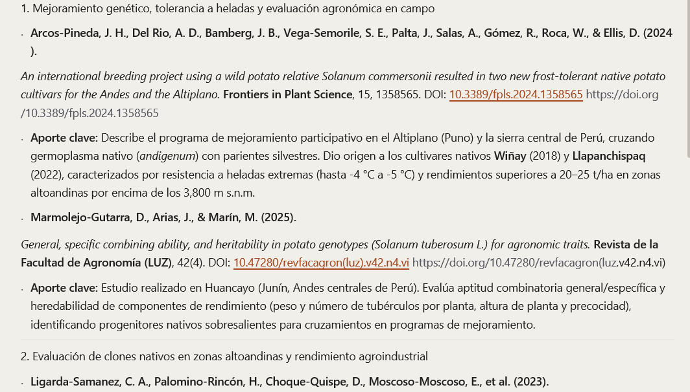{width=100% fig-alt="Resultado de la búsqueda de bibliografía"}

# Generación de teorías

```{=typst}
#prompt("Escribe en Mini-Me")[
  Genera hipótesis y la síntesis de teorías mecanísticas a partir de la literatura científica
  recopilada.
]

#nota[
  Las teorías e hipótesis son propuestas para poner a prueba, no conclusiones. Pregúntate qué dato
  haría falta para refutar cada una.
]
```

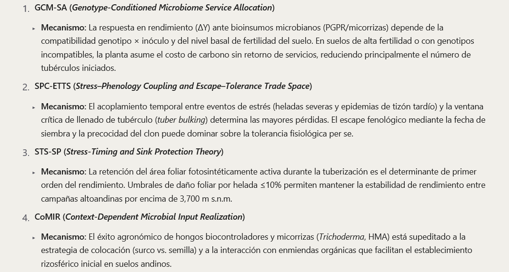{width=100% fig-alt="Teorías mecanísticas generadas a partir de la literatura"}

# Reporte de bibliografía

```{=typst}
#prompt("Escribe en Mini-Me")[
  Reporte de la bibliografía de rendimiento de papas nativas en Perú.
]
```

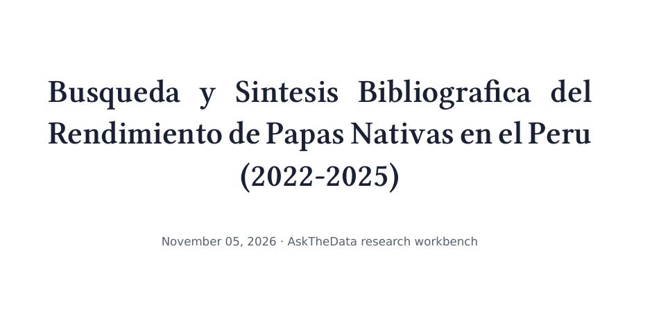{width=80% fig-alt="Portada del reporte de bibliografía generado"}

# Si algo no sale como esperabas

| Qué pasa | Qué hacer |
|---|---|
| No puedes guardar archivos ("read-only" o "no permission") | Trabaja desde la carpeta del Escritorio, no desde `C:\` |
| Mini-Me no avanza | Revisa si hay una tarjeta **RUN THIS ON YOUR MACHINE** esperando tu aprobación |
| Tus cifras no coinciden con las de esta guía | Es normal que varíen un poco. Pregúntale a Mini-Me de dónde sale cada número |
| No entiendes un comando o un resultado | Pregúntale a Mini-Me qué hace o qué significa, antes de aprobar o de usarlo |

: {tbl-colwidths="[45,55]"}

```{=typst}
#nota[
  *La IA acelera el trabajo; tú le das dirección.* Revisa cada resultado antes de usarlo: esa
  revisión es parte del método, no un paso extra.
]
```
