## Qué vamos a lograr hoy

```{=html}
<svg class="ciclo mapa flujo" viewBox="0 0 1400 330" xmlns="http://www.w3.org/2000/svg" role="img"
     aria-label="Cinco pasos: crear, cargar, diagnosticar, limpiar y analizar">
  <defs>
    <filter id="aspero-f1" filterUnits="userSpaceOnUse" x="-1400" y="-330" width="2800" height="660">
      <feTurbulence type="fractalNoise" baseFrequency="0.035" numOctaves="2" seed="3"/>
      <feDisplacementMap in="SourceGraphic" scale="3.5" xChannelSelector="R" yChannelSelector="G"/>
    </filter>
  </defs>
  <g class="fragment">
    <g class="nodo prep" transform="translate(140 120)">
      <circle r="92" class="trazo" filter="url(#aspero-f1)"/>
      <ellipse rx="94" ry="88" transform="rotate(-10)" class="trazo2" filter="url(#aspero-f1)"/>
      <text class="nombre" y="-8"><tspan class="num">1</tspan><tspan x="0" dy="38">Crear</tspan></text>
    </g>
    <text class="pie" x="140" y="258">tu proyecto<tspan x="140" dy="28">en Mini-Me</tspan></text>
  </g>
  <g class="fragment">
    <path class="flecha" pathLength="1" d="M 242 120 L 318 120" filter="url(#aspero-f1)"/>
    <g class="nodo prep" transform="translate(420 120)">
      <circle r="92" class="trazo" filter="url(#aspero-f1)"/>
      <ellipse rx="94" ry="89" transform="rotate(8)" class="trazo2" filter="url(#aspero-f1)"/>
      <text class="nombre" y="-8"><tspan class="num">2</tspan><tspan x="0" dy="38">Cargar</tspan></text>
    </g>
    <text class="pie" x="420" y="258">un dataset<tspan x="420" dy="28">de campo</tspan></text>
  </g>
  <g class="fragment">
    <path class="flecha" pathLength="1" d="M 522 120 L 598 120" filter="url(#aspero-f1)"/>
    <g class="nodo prep" transform="translate(700 120)">
      <circle r="92" class="trazo" filter="url(#aspero-f1)"/>
      <ellipse rx="94" ry="88" transform="rotate(-6)" class="trazo2" filter="url(#aspero-f1)"/>
      <text class="nombre chica" y="-8"><tspan class="num">3</tspan><tspan x="0" dy="38">Diagnosticar</tspan></text>
    </g>
    <text class="pie" x="700" y="258">errores e<tspan x="700" dy="28">inconsistencias</tspan></text>
  </g>
  <g class="fragment">
    <path class="flecha" pathLength="1" d="M 802 120 L 878 120" filter="url(#aspero-f1)"/>
    <g class="nodo prep" transform="translate(980 120)">
      <circle r="92" class="trazo" filter="url(#aspero-f1)"/>
      <ellipse rx="94" ry="89" transform="rotate(10)" class="trazo2" filter="url(#aspero-f1)"/>
      <text class="nombre" y="-8"><tspan class="num">4</tspan><tspan x="0" dy="38">Limpiar</tspan></text>
    </g>
    <text class="pie" x="980" y="258">y obtener<tspan x="980" dy="28">un informe</tspan></text>
  </g>
  <g class="fragment">
    <path class="flecha" pathLength="1" d="M 1082 120 L 1158 120" filter="url(#aspero-f1)"/>
    <g class="nodo anal" transform="translate(1260 120)">
      <circle r="92" class="trazo" filter="url(#aspero-f1)"/>
      <ellipse rx="94" ry="88" transform="rotate(-8)" class="trazo2" filter="url(#aspero-f1)"/>
      <text class="nombre" y="-8"><tspan class="num">5</tspan><tspan x="0" dy="38">Analizar</tspan></text>
    </g>
    <text class="pie" x="1260" y="258">con un ANOVA<tspan x="1260" dy="28">de rendimiento</tspan></text>
  </g>
</svg>
```

::: {.dato-base}
Dataset de trabajo: `mejoramiento_dirty.csv` · 30 genotipos en 3 localidades · 274 filas, 33 variables
:::

::: notes
Bienvenida. Presentar el objetivo del taller: usar Mini-Me para pasar de un dataset de campo
con errores a un análisis estadístico, siempre revisando lo que hace la IA.
:::

## Antes de empezar

:::: {.columns}
::: {.column width="56%"}
::: {.checklist}
- **Mini-Me Desktop** instalado y con la sesión iniciada
- **Carpeta Taller Mini-me** en tu Escritorio, con `mejoramiento_dirty.csv` y la carpeta `datasets`
- **Guía impresa o en PDF** para seguir paso a paso
:::
:::

::: {.column width="40%"}
::: {.tarjeta .alerta}
[Importante]{.kicker-t}

Trabaja siempre desde la carpeta del **Escritorio**.

En las laptops institucionales, las carpetas en `C:\` pueden impedir que guardes archivos
("read-only" o "no permission").
:::
:::
::::

## Conoce la pantalla de Mini-Me

:::: {.columns}
::: {.column width="62%"}
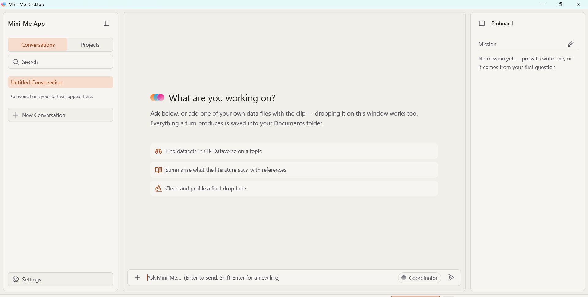{.captura fig-alt="Pantalla inicial de Mini-Me Desktop"}
:::

::: {.column width="35%"}
::: {.lista-pantalla}
- **Izquierda:** Conversations y Projects
- **Centro:** la conversación; escribe abajo (Enter envía)
- **Derecha:** Pinboard con la Mission del trabajo
- **Atajos:** Dataverse, literatura y **Clean and profile a file** (el que usaremos)
- Todo lo que produce se guarda en **Documentos**
:::
:::
::::

::: notes
Mostrar en pantalla las tres zonas. Recalcar que el tercer atajo, "Clean and profile a file I
drop here", es el del ejercicio.
:::

## Paso 1 · Crea el proyecto Taller_Mini-me

:::: {.columns}
::: {.column width="44%"}
::: {.pasos}
1. Haz clic en la pestaña **Projects**
2. Haz clic en **+ New Project**
3. Escribe **Taller_Mini-me** y pulsa **Create**
4. Se abre una conversación nueva: **ahí haremos todo**
:::
:::

::: {.column width="54%"}
::: {.par-capturas}
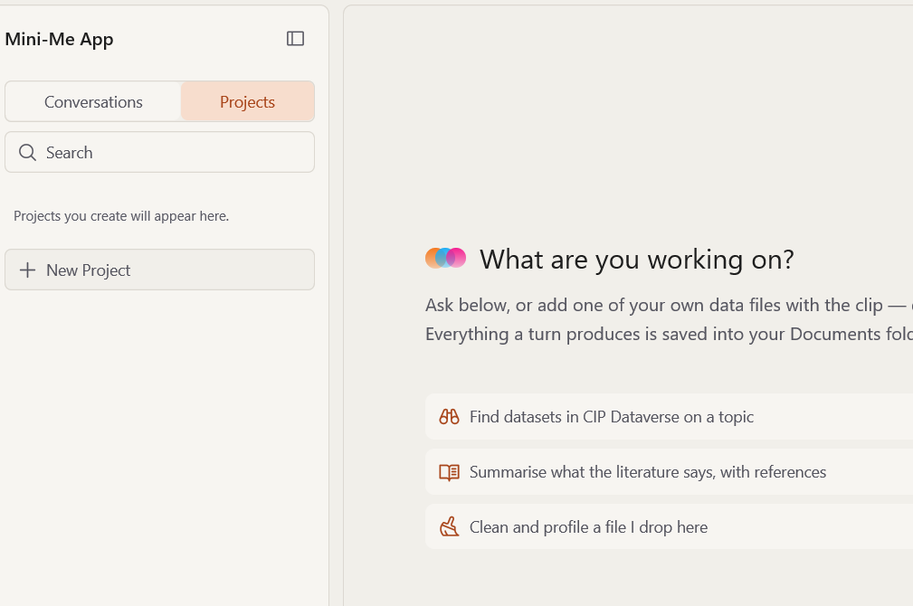{.captura fig-alt="Pestaña Projects y botón New Project"}

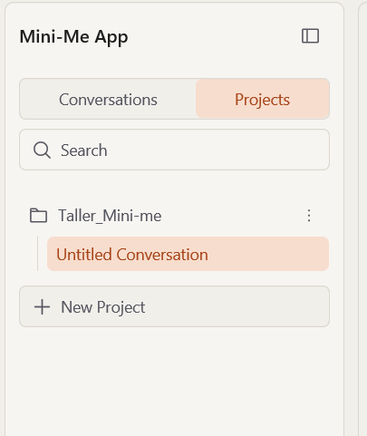{.captura .angosta fig-alt="Proyecto Taller_Mini-me creado"}
:::
:::
::::

## Paso 2 · Carga el archivo de datos

:::: {.columns}
::: {.column width="42%"}
::: {.pasos}
1. Haz clic en **+** en la barra de mensajes (o arrastra el archivo)
2. Abre **Escritorio › Taller Mini-me**
3. Elige **mejoramiento_dirty.csv** y pulsa **Open**
4. El archivo aparece como una etiqueta sobre la barra de mensajes
:::
:::

::: {.column width="56%"}
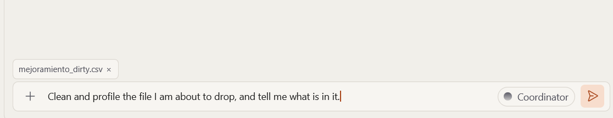{.captura fig-alt="Archivo adjuntado en la barra de mensajes"}

::: {.tarjeta}
[Dónde trabaja Mini-Me]{.kicker-t}

Cada conversación guarda sus archivos en su propia carpeta, dentro de **Documentos › Mini-Me ›
Taller_Mini-me**.
:::
:::
::::

## Antes de seguir · Revisa y aprueba los comandos

:::: {.columns}
::: {.column width="56%"}
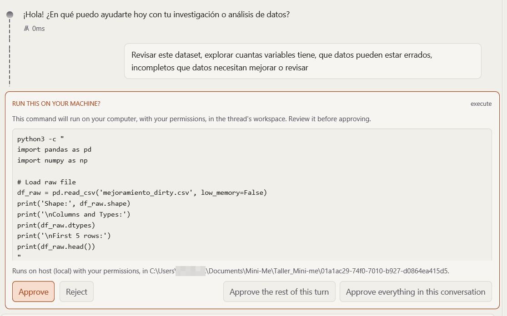{.captura fig-alt="Solicitud RUN THIS ON YOUR MACHINE"}
:::

::: {.column width="41%"}
::: {.tabla-botones}
| Botón | Qué hace |
|---|---|
| **Approve** | Ejecuta solo este comando |
| **Reject** | No lo ejecuta |
| **Approve the rest of this turn** | Aprueba los comandos de esta respuesta |
| **Approve everything…** | Aprueba toda la conversación (solo con datos de prueba) |
:::

::: {.tarjeta .alerta}
**Buena práctica:** lee el código antes de aprobar. Si no lo entiendes, pregúntale a Mini-Me qué
hace.
:::
:::
::::

## Paso 3 · Revisa, limpia y estandariza los datos

```{=html}
<svg class="ciclo mapa flujo cajas" viewBox="0 0 1400 280" xmlns="http://www.w3.org/2000/svg" role="img"
     aria-label="Cinco instrucciones: estructura, diagnóstico, recomendaciones, reporte y limpieza">
  <defs>
    <filter id="aspero-f2" filterUnits="userSpaceOnUse" x="-1400" y="-280" width="2800" height="560">
      <feTurbulence type="fractalNoise" baseFrequency="0.035" numOctaves="2" seed="9"/>
      <feDisplacementMap in="SourceGraphic" scale="3.5" xChannelSelector="R" yChannelSelector="G"/>
    </filter>
  </defs>
  <g class="fragment">
    <g class="caja-paso" transform="translate(20 30)">
      <rect width="240" height="210" rx="18" class="trazo" filter="url(#aspero-f2)"/>
      <text class="numero" x="120" y="62">01</text>
      <text class="titulo" x="120" y="112">Estructura</text>
      <text class="desc" x="120" y="150">Filas, variables<tspan x="120" dy="26">y tipos</tspan></text>
    </g>
  </g>
  <g class="fragment">
    <path class="flecha" pathLength="1" d="M 266 135 L 294 135" filter="url(#aspero-f2)"/>
    <g class="caja-paso" transform="translate(300 30)">
      <rect width="240" height="210" rx="18" class="trazo" filter="url(#aspero-f2)"/>
      <text class="numero" x="120" y="62">02</text>
      <text class="titulo" x="120" y="112">Diagnóstico</text>
      <text class="desc" x="120" y="150">Faltantes, duplicados<tspan x="120" dy="26">e imposibles</tspan></text>
    </g>
  </g>
  <g class="fragment">
    <path class="flecha" pathLength="1" d="M 546 135 L 574 135" filter="url(#aspero-f2)"/>
    <g class="caja-paso" transform="translate(580 30)">
      <rect width="240" height="210" rx="18" class="trazo" filter="url(#aspero-f2)"/>
      <text class="numero" x="120" y="62">03</text>
      <text class="titulo" x="120" y="112">Recomendaciones</text>
      <text class="desc" x="120" y="150">Cómo corregir<tspan x="120" dy="26">cada problema</tspan></text>
    </g>
  </g>
  <g class="fragment">
    <path class="flecha" pathLength="1" d="M 826 135 L 854 135" filter="url(#aspero-f2)"/>
    <g class="caja-paso" transform="translate(860 30)">
      <rect width="240" height="210" rx="18" class="trazo" filter="url(#aspero-f2)"/>
      <text class="numero" x="120" y="62">04</text>
      <text class="titulo" x="120" y="112">Reporte</text>
      <text class="desc" x="120" y="150">Informe técnico<tspan x="120" dy="26">en .md y PDF</tspan></text>
    </g>
  </g>
  <g class="fragment">
    <path class="flecha" pathLength="1" d="M 1106 135 L 1134 135" filter="url(#aspero-f2)"/>
    <g class="caja-paso destacada" transform="translate(1140 30)">
      <rect width="240" height="210" rx="18" class="trazo" filter="url(#aspero-f2)"/>
      <text class="numero" x="120" y="62">05</text>
      <text class="titulo" x="120" y="112">Limpieza</text>
      <text class="desc" x="120" y="150">Dataset curado en<tspan x="120" dy="26">un archivo nuevo</tspan></text>
    </g>
  </g>
</svg>
```

::: {.dato-base}
Envía **una instrucción a la vez** y espera a que termine. Las instrucciones completas están en la
guía.
:::

::: notes
Enviar una instrucción a la vez y esperar a que termine. Las instrucciones completas 01 a 05 están
en la guía impresa.
:::

## Qué deberíamos encontrar (01–02)

:::: {.columns}
::: {.column width="49%"}
::: {.prompt-box .numerado .chico-p}
[01]{.num-p} Revisa la estructura y las dimensiones de este dataset: cuántas filas y variables
tiene, de qué tipo es cada variable y qué representa.
:::
:::

::: {.column width="49%"}
::: {.prompt-box .numerado .chico-p}
[02]{.num-p} Revisa las inconsistencias y los datos incompletos: valores faltantes, duplicados,
valores imposibles y errores de unidades.
:::
:::
::::

::: {.cifras-gancho .cifras-taller}
::: {.cifra-bloque .fragment}
[274]{.cifra .contador data-hasta="274"}
[filas]{.cifra-label}
:::

::: {.cifra-bloque .fragment}
[33]{.cifra .contador data-hasta="33"}
[variables]{.cifra-label}
:::

::: {.cifra-bloque .fragment}
[7]{.cifra .contador data-hasta="7"}
[parcelas duplicadas]{.cifra-label}
:::

::: {.cifra-bloque .fragment}
[3–15 %]{.cifra}
[datos faltantes]{.cifra-label}
:::
:::

::: {.hallazgos .fragment}
- **Diseño:** `rep = 0`, `rep = 4` (solo hay 3 repeticiones) y 9 parcelas sin repetición
- **Ubicación:** altitudes de 10 551 a 13 346 "msnm" (en realidad pies) y localidades escritas de varias formas
- **Valores imposibles:** negativos (`ntp = −50`) y `ntp = 375` en una parcela de 10 tubérculos sembrados
- **Escala:** rendimientos ×1000 (kg/ha registrados como t/ha) y pesos en libras
- **Nombres:** `añil papa` en minúsculas y códigos con espacios crean genotipos "falsos"
:::

::: notes
Cifras de referencia, calculadas a partir del registro de errores sembrados en el dataset. El
informe de Mini-Me de cada participante puede contarlas de forma ligeramente distinta.
:::

## De las recomendaciones al dataset curado (03–05)

:::: {.columns}
::: {.column width="48%"}
::: {.tarjeta}
[Ejemplo de recomendación (03)]{.kicker-t}

- Unificar las tres localidades: **Ccasapata** (3766 msnm), **Ccollpaccasa** (4068) y **La Victoria** (3216)
- Pasar a metros las altitudes registradas en pies
- Volver a kg y t/ha los pesos en libras y los rendimientos en kg/ha
:::

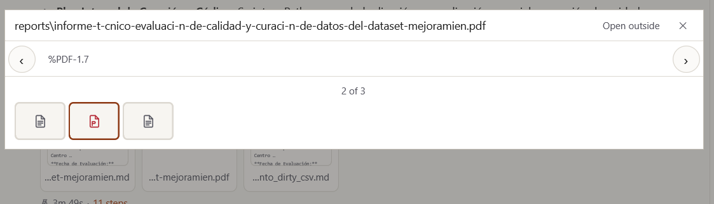{.captura fig-alt="Vista previa del informe generado"}
:::

::: {.column width="49%"}
::: {.prompt-box .numerado .chico-p}
[03]{.num-p} Dame recomendaciones de limpieza y estandarización de datos para cada problema
encontrado.
:::

::: {.prompt-box .numerado .chico-p}
[04]{.num-p} Genera un reporte técnico en PDF con el diagnóstico y el plan de limpieza.
:::

::: {.prompt-box .numerado .chico-p}
[05]{.num-p} Procede con la estandarización y limpieza de los datos, siguiendo las
recomendaciones. Guarda el dataset curado como un archivo nuevo y no modifiques el original.
:::

::: {.tarjeta .bien}
[Resultado esperado]{.kicker-t}

- **267** parcelas únicas, sin duplicados
- **3 localidades** estandarizadas, con su altitud en metros
- Unidades corregidas y variables derivadas recalculadas
- El archivo original **queda intacto**
:::
:::
::::

## Paso 4 · Ubica tus archivos

::: {.ruta}
`Documentos › Mini-Me › Taller_Mini-me › (carpeta con código de la conversación)`
:::

:::: {.columns}
::: {.column width="58%"}
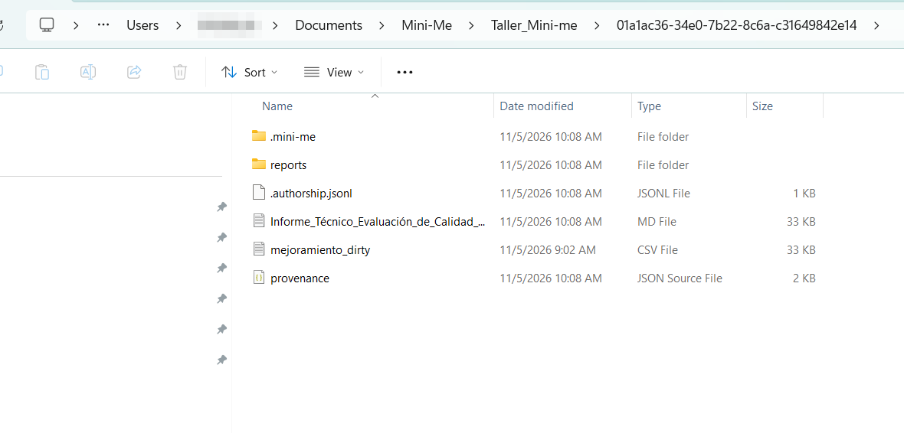{.captura fig-alt="Carpeta de resultados del proyecto"}
:::

::: {.column width="39%"}
::: {.lista-pantalla}
- **mejoramiento_dirty.csv:** copia del original
- **Informe .md y carpeta reports:** informe técnico en PDF
- **provenance.json y .authorship.jsonl:** registro de lo que se hizo (trazabilidad)
:::
:::
::::

## Paso 5 · ¿Qué análisis se pueden hacer?

:::: {.columns}
::: {.column width="58%"}
::: {.prompt-box .numerado .chico-p}
[06]{.num-p} Con el dataset curado, propón qué análisis se pueden hacer. ¿Cuál de los genotipos
evaluados rinde más, en promedio y en cada localidad?
:::

::: {.tabla-botones}
| Puesto | Genotipo | Variedad | ttya medio (t/ha) |
|---|---|---|---|
| 1 | CIP701675 | Tarmeña | 31.7 |
| 2 | CIP703168 | Puca Pishgush | 31.0 |
| 3 | CIP705543 | Yana Warmi | 30.0 |
| 4 | CIP704327 | Color Unckuna | 28.2 |
| 5 | CIP702363 | Socco Huaccoto | 26.7 |
:::

[Referencia: promedio de las tres localidades, calculado sobre el dataset limpio.]{.nota-chica}
:::

::: {.column width="39%"}
::: {.prompt-box .numerado .chico-p}
[07]{.num-p} Dame recomendaciones de análisis estadístico para este ensayo.
:::

::: {.analisis}
[Análisis recomendados (07)]{.kicker-t}

1. **ANOVA combinado y comparación de medias** [hoy hacemos este]{.hoy}
2. Estabilidad: AMMI o GGE biplot
3. Modelos mixtos y BLUPs
4. Correlación entre caracteres
5. Índice de selección multicarácter
:::
:::
::::

## Paso 6 · ANOVA para rendimiento ajustado (ttya)

::: {.prompt-box .numerado .chico-p}
[08]{.num-p} Realiza un ANOVA combinado para el rendimiento ajustado (ttya) con el dataset curado:
genotipo (instn), localidad (locality) y su interacción, con la repetición dentro de cada localidad
como bloque. Incluye la prueba de Tukey HSD y un gráfico del rendimiento de cada genotipo en las tres
localidades.
:::

:::: {.columns}
::: {.column width="60%"}
::: {.tabla-botones}
| Fuente | p | Qué dice |
|---|---|---|
| Localidad | < 0.001 | La Victoria rinde el doble que Ccasapata |
| Genotipo | < 0.001 | Hay genotipos mejores que otros |
| Genotipo × localidad | < 0.001 | **El ranking cambia según la localidad** |
| Repetición (localidad) | 0.31 | Los bloques no difieren |
:::

[Referencia calculada sobre el dataset limpio.]{.nota-chica}
:::

::: {.column width="37%"}
::: {.tarjeta}
[Cómo leerlo]{.kicker-t}

- **p (genotipo) < 0.05:** hay diferencias entre genotipos
- **p (interacción) < 0.05:** el mejor en un sitio no es el mejor en todos
- **Tukey:** misma letra = no difieren
:::

::: {.tarjeta .alerta}
**Ojo:** Socco Huaccoto es 2.º en Ccollpaccasa y 13.º en La Victoria. ¿Lo recomendarías?
:::
:::
::::

::: notes
Discusión en grupo: ¿coinciden los primeros lugares del ranking (instrucción 06) y del ANOVA? Si la
interacción es significativa, ¿conviene recomendar un genotipo para las tres localidades o uno por
localidad? Una parcela de Puca Pishgush llega a 60,7 t/ha en La Victoria, más del doble de la media
de esa localidad: ¿es real?
:::

## Paso 7 · Revisión de bibliografía

::: {.prompt-box .numerado .chico-p}
[09]{.num-p} Busca información de rendimiento de papa en Junín y Huancavelica en los últimos 5 años.
:::

:::: {.columns}
::: {.column width="52%"}
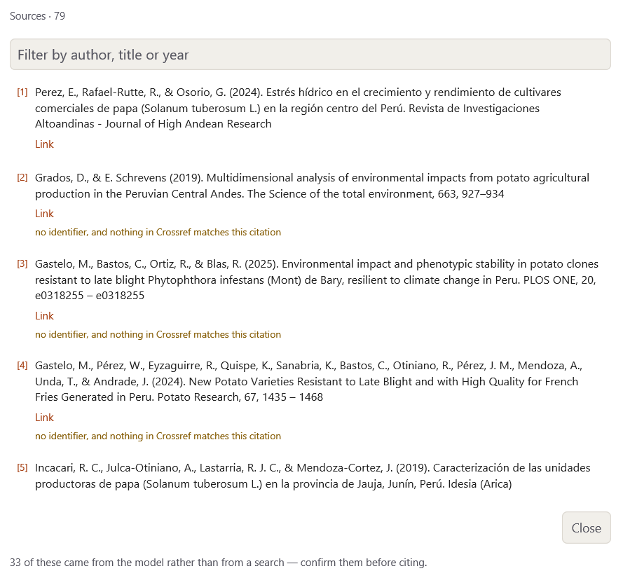{.captura fig-alt="Lista de fuentes que devuelve Mini-Me, con avisos en las citas sin identificador"}
:::

::: {.column width="45%"}
::: {.tarjeta}
[Qué te devuelve]{.kicker-t}

- Un resumen con cifras de rendimiento y su fuente
- La lista de **fuentes**, cada una con su enlace
- Un aviso en cada cita **sin identificador** o que no aparece en Crossref
:::

::: {.tarjeta .alerta}
[Verifica antes de citar]{.kicker-t}

En esta corrida de prueba, **33 de 79 fuentes** vinieron del modelo y no de una búsqueda. Abre al
menos dos y confirma que existen.
:::
:::
::::

::: notes
Bloque de herramientas de Allen AI. La captura es de una corrida de prueba con una búsqueda sobre
Junín: el número de fuentes y las citas cambian en cada corrida. Mostrar el aviso al pie de la
lista ("came from the model rather than from a search") y los avisos de Crossref.
:::

## Paso 7 · Generación de teorías

::: {.prompt-box .numerado .chico-p}
[10]{.num-p} Usa el subagente hypothesis_generator para sintetizar teorías basadas en la literatura a
partir de las fuentes reunidas hasta ahora.
:::

:::: {.columns}
::: {.column width="31%"}
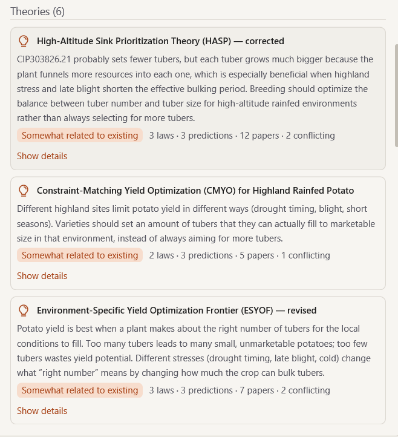{.captura style="max-height: 470px;" fig-alt="Lista de teorías generadas en el Pinboard"}
:::

::: {.column width="27%"}
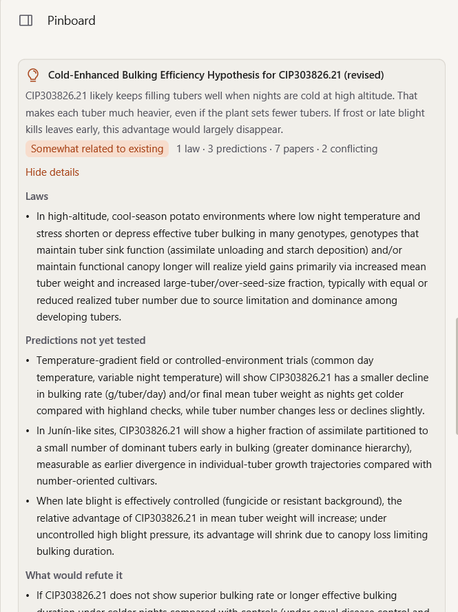{.captura style="max-height: 470px;" fig-alt="Detalle de una teoría: leyes, predicciones y qué la refutaría"}
:::

::: {.column width="38%"}
::: {.tarjeta}
[Qué trae cada teoría]{.kicker-t}

- **Leyes:** el mecanismo que propone
- **Predicciones** que todavía no se han probado
- **Qué la refutaría**
- Artículos que la respaldan y los que la contradicen
:::

::: {.tarjeta .alerta}
Son **hipótesis para probar**, no resultados. ¿Qué dato las refutaría?
:::

[Capturas de una corrida de prueba con un ensayo anterior: tus teorías serán distintas.]{.nota-chica}
:::
::::

::: notes
Las teorías aparecen en el Pinboard, a la derecha. Abrir una con "Show details" y leer en voz alta
una predicción y qué la refutaría. Las capturas vienen de una corrida con el ensayo anterior de La
Victoria (clon CIP303826.21), que no está en el dataset de hoy.
:::

## Del análisis a una presentación

:::: {.columns}
::: {.column width="62%"}
::: {.rejilla-ppt}
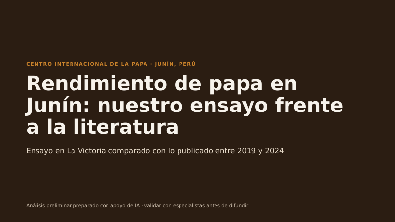{.captura fig-alt="Portada de la presentación de ejemplo"}

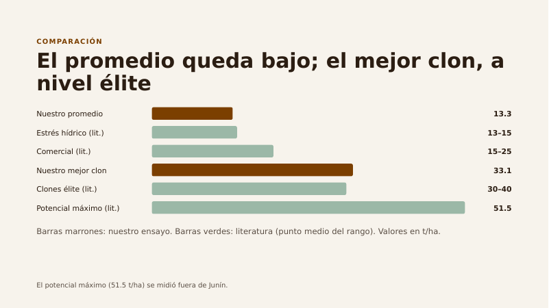{.captura fig-alt="Comparación del ensayo con la literatura"}

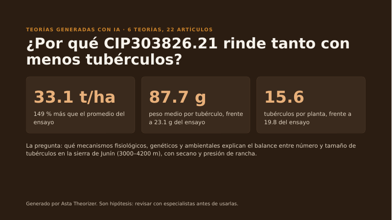{.captura fig-alt="Pregunta que da origen a las teorías"}

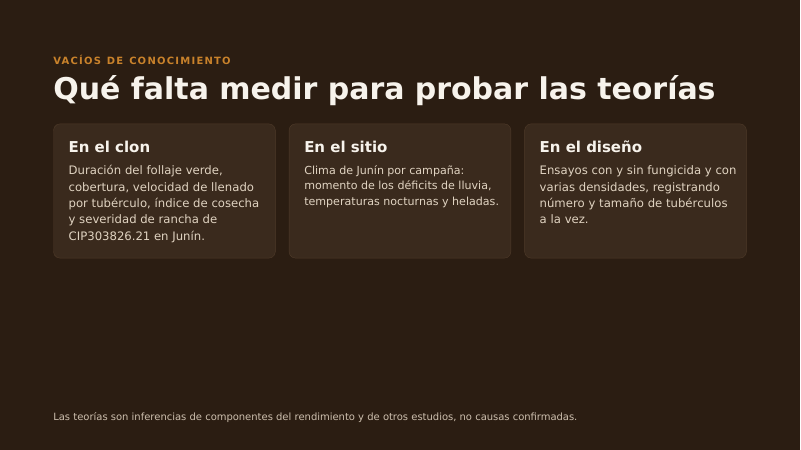{.captura fig-alt="Vacíos de conocimiento: qué falta medir"}
:::
:::

::: {.column width="35%"}
::: {.tarjeta}
[Un ejemplo del producto final]{.kicker-t}

Con el análisis, la bibliografía y las teorías, Claude armó una presentación de 11 diapositivas:
el ensayo frente a la literatura, seis teorías y qué falta medir.
:::

::: {.tarjeta .bien}
[Lo que hace bien]{.kicker-t}

- Dice que es **preliminar** y hecha con IA
- Marca qué cifras **no son de Junín**
- Señala las referencias **sin verificar**
:::

[Ejemplo hecho con un ensayo anterior (La Victoria, 2016): sus cifras no son las del dataset de hoy.]{.nota-chica}
:::
::::

::: notes
Ejemplo de cierre de la cadena: datos, literatura, teorías y una presentación para compartir. La
presentación se hizo con el ensayo anterior de La Victoria (61 clones, 2016), por eso el promedio
(13,3 t/ha) y el mejor clon (33,1 t/ha) no coinciden con el dataset de tres localidades. Sirve de
puente al Reto Mini-Me: cada equipo termina con un pitch.
:::

## {.logos .mini-me-final}
