## Qué vamos a lograr hoy

```{=html}
<svg class="ciclo mapa flujo" viewBox="0 0 1400 330" xmlns="http://www.w3.org/2000/svg" role="img"
     aria-label="Cinco pasos: crear, cargar, diagnosticar, limpiar y analizar">
  <defs>
    <filter id="aspero-f1" filterUnits="userSpaceOnUse" x="-1400" y="-330" width="2800" height="660">
      <feTurbulence type="fractalNoise" baseFrequency="0.035" numOctaves="2" seed="3"/>
      <feDisplacementMap in="SourceGraphic" scale="3.5" xChannelSelector="R" yChannelSelector="G"/>
    </filter>
  </defs>
  <g class="fragment">
    <g class="nodo prep" transform="translate(140 120)">
      <circle r="92" class="trazo" filter="url(#aspero-f1)"/>
      <ellipse rx="94" ry="88" transform="rotate(-10)" class="trazo2" filter="url(#aspero-f1)"/>
      <text class="nombre" y="-8"><tspan class="num">1</tspan><tspan x="0" dy="38">Crear</tspan></text>
    </g>
    <text class="pie" x="140" y="258">tu proyecto<tspan x="140" dy="28">en Mini-Me</tspan></text>
  </g>
  <g class="fragment">
    <path class="flecha" pathLength="1" d="M 242 120 L 318 120" filter="url(#aspero-f1)"/>
    <g class="nodo prep" transform="translate(420 120)">
      <circle r="92" class="trazo" filter="url(#aspero-f1)"/>
      <ellipse rx="94" ry="89" transform="rotate(8)" class="trazo2" filter="url(#aspero-f1)"/>
      <text class="nombre" y="-8"><tspan class="num">2</tspan><tspan x="0" dy="38">Cargar</tspan></text>
    </g>
    <text class="pie" x="420" y="258">un dataset<tspan x="420" dy="28">de campo</tspan></text>
  </g>
  <g class="fragment">
    <path class="flecha" pathLength="1" d="M 522 120 L 598 120" filter="url(#aspero-f1)"/>
    <g class="nodo prep" transform="translate(700 120)">
      <circle r="92" class="trazo" filter="url(#aspero-f1)"/>
      <ellipse rx="94" ry="88" transform="rotate(-6)" class="trazo2" filter="url(#aspero-f1)"/>
      <text class="nombre chica" y="-8"><tspan class="num">3</tspan><tspan x="0" dy="38">Diagnosticar</tspan></text>
    </g>
    <text class="pie" x="700" y="258">errores e<tspan x="700" dy="28">inconsistencias</tspan></text>
  </g>
  <g class="fragment">
    <path class="flecha" pathLength="1" d="M 802 120 L 878 120" filter="url(#aspero-f1)"/>
    <g class="nodo prep" transform="translate(980 120)">
      <circle r="92" class="trazo" filter="url(#aspero-f1)"/>
      <ellipse rx="94" ry="89" transform="rotate(10)" class="trazo2" filter="url(#aspero-f1)"/>
      <text class="nombre" y="-8"><tspan class="num">4</tspan><tspan x="0" dy="38">Limpiar</tspan></text>
    </g>
    <text class="pie" x="980" y="258">y obtener<tspan x="980" dy="28">un informe</tspan></text>
  </g>
  <g class="fragment">
    <path class="flecha" pathLength="1" d="M 1082 120 L 1158 120" filter="url(#aspero-f1)"/>
    <g class="nodo anal" transform="translate(1260 120)">
      <circle r="92" class="trazo" filter="url(#aspero-f1)"/>
      <ellipse rx="94" ry="88" transform="rotate(-8)" class="trazo2" filter="url(#aspero-f1)"/>
      <text class="nombre" y="-8"><tspan class="num">5</tspan><tspan x="0" dy="38">Analizar</tspan></text>
    </g>
    <text class="pie" x="1260" y="258">con un ANOVA<tspan x="1260" dy="28">de rendimiento</tspan></text>
  </g>
</svg>
```

::: {.dato-base}
Dataset de trabajo: `mejoramiento_dirty.csv` · 250 parcelas, 21 variables
:::

::: notes
Bienvenida. Presentar el objetivo del taller: usar Mini-Me para pasar de un dataset de campo
con errores a un análisis estadístico, siempre revisando lo que hace la IA.
:::

## Antes de empezar

:::: {.columns}
::: {.column width="56%"}
::: {.checklist}
- **Mini-Me Desktop** instalado y con la sesión iniciada
- **Carpeta Taller Mini-me** en tu Escritorio, con `mejoramiento_dirty.csv` y la carpeta `datasets`
- **Guía impresa o en PDF** para seguir paso a paso
:::
:::

::: {.column width="40%"}
::: {.tarjeta .alerta}
[Importante]{.kicker-t}

Trabaja siempre desde la carpeta del **Escritorio**.

En las laptops institucionales, las carpetas en `C:\` pueden impedir que guardes archivos
("read-only" o "no permission").
:::
:::
::::

## Paso 1 · Conoce la pantalla de Mini-Me

:::: {.columns}
::: {.column width="62%"}
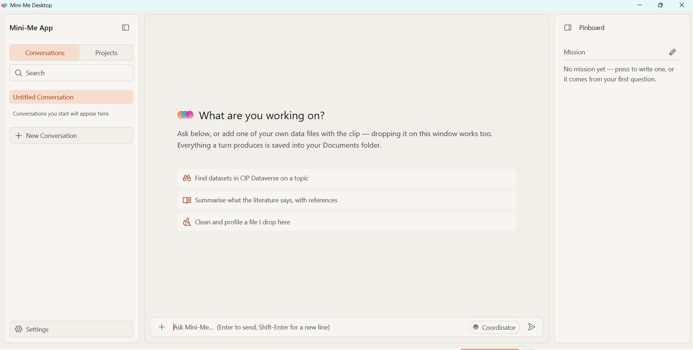{.captura fig-alt="Pantalla inicial de Mini-Me Desktop"}
:::

::: {.column width="35%"}
::: {.lista-pantalla}
- **Izquierda:** Conversations y Projects
- **Centro:** la conversación; escribe abajo (Enter envía)
- **Derecha:** Pinboard con la Mission del trabajo
- **Atajos:** Dataverse, literatura y **Clean and profile a file** (el que usaremos)
- Todo lo que produce se guarda en **Documentos**
:::
:::
::::

::: notes
Mostrar en pantalla las tres zonas. Recalcar que el tercer atajo, "Clean and profile a file I
drop here", es el del ejercicio.
:::

## Paso 2 · Crea el proyecto Taller_Mini-me

:::: {.columns}
::: {.column width="44%"}
::: {.pasos}
1. Haz clic en la pestaña **Projects**
2. Haz clic en **+ New Project**
3. Escribe **Taller_Mini-me** y pulsa **Create**
4. Se abre una conversación nueva: **ahí haremos todo**
:::
:::

::: {.column width="54%"}
::: {.par-capturas}
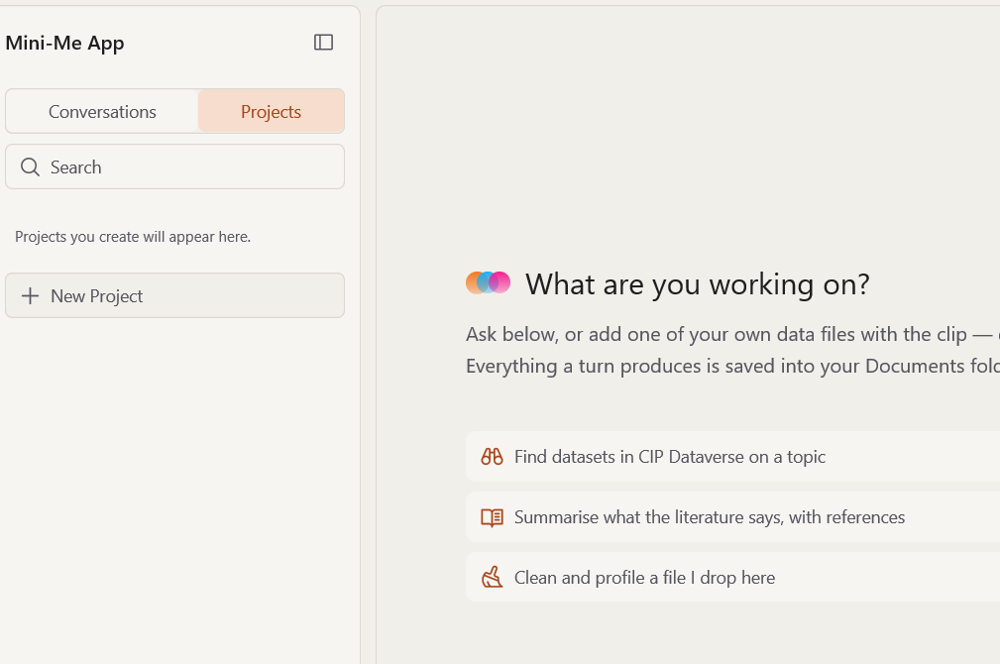{.captura fig-alt="Pestaña Projects y botón New Project"}

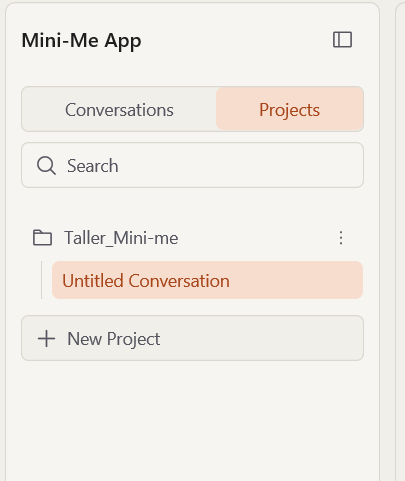{.captura .angosta fig-alt="Proyecto Taller_Mini-me creado"}
:::
:::
::::

## Pasos 3 y 4 · Prueba y carga el archivo

:::: {.columns}
::: {.column width="48%"}
::: {.subpaso}
3 · Prueba
:::

::: {.prompt-box}
[Escribe en Mini-Me]{.kicker-p}
hola
:::

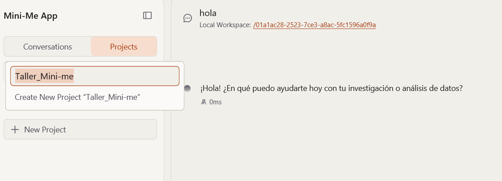{.captura fig-alt="Primera respuesta de Mini-Me"}
:::

::: {.column width="48%"}
::: {.subpaso}
4 · Carga el archivo
:::

::: {.pasos .compacta}
1. Clic en **+** en la barra de mensajes (o arrastra el archivo)
2. Abre **Escritorio › Taller Mini-me**
3. Elige **mejoramiento_dirty.csv** y pulsa **Open**
:::

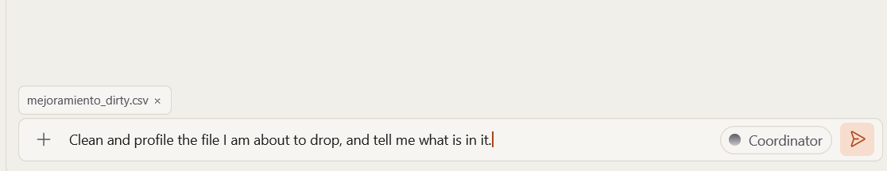{.captura fig-alt="Archivo adjuntado en la barra de mensajes"}
:::
::::

::: {.ruta}
`C:\Users\«tu usuario»\Documents\Mini-Me\Taller_Mini-me\«código de la conversación»`
:::

## Paso 5 · Revisa y aprueba los comandos

:::: {.columns}
::: {.column width="56%"}
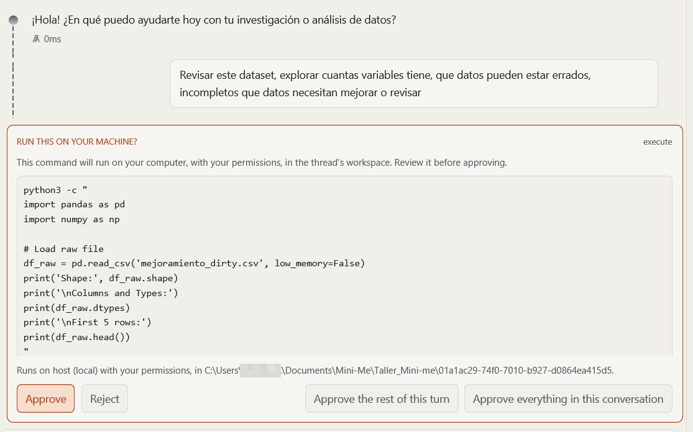{.captura fig-alt="Solicitud RUN THIS ON YOUR MACHINE"}
:::

::: {.column width="41%"}
::: {.tabla-botones}
| Botón | Qué hace |
|---|---|
| **Approve** | Ejecuta solo este comando |
| **Reject** | No lo ejecuta |
| **Approve the rest of this turn** | Aprueba los comandos de esta respuesta |
| **Approve everything…** | Aprueba toda la conversación (solo con datos de prueba) |
:::

::: {.tarjeta .alerta}
**Buena práctica:** lee el código antes de aprobar. Si no lo entiendes, pregúntale a Mini-Me qué
hace.
:::
:::
::::

## Paso 6 · Cinco instrucciones, en orden

```{=html}
<svg class="ciclo mapa flujo cajas" viewBox="0 0 1400 280" xmlns="http://www.w3.org/2000/svg" role="img"
     aria-label="Cinco instrucciones: estructura, diagnóstico, recomendaciones, reporte y limpieza">
  <defs>
    <filter id="aspero-f2" filterUnits="userSpaceOnUse" x="-1400" y="-280" width="2800" height="560">
      <feTurbulence type="fractalNoise" baseFrequency="0.035" numOctaves="2" seed="9"/>
      <feDisplacementMap in="SourceGraphic" scale="3.5" xChannelSelector="R" yChannelSelector="G"/>
    </filter>
  </defs>
  <g class="fragment">
    <g class="caja-paso" transform="translate(20 30)">
      <rect width="240" height="210" rx="18" class="trazo" filter="url(#aspero-f2)"/>
      <text class="numero" x="120" y="62">01</text>
      <text class="titulo" x="120" y="112">Estructura</text>
      <text class="desc" x="120" y="150">Filas, variables<tspan x="120" dy="26">y tipos</tspan></text>
    </g>
  </g>
  <g class="fragment">
    <path class="flecha" pathLength="1" d="M 266 135 L 294 135" filter="url(#aspero-f2)"/>
    <g class="caja-paso" transform="translate(300 30)">
      <rect width="240" height="210" rx="18" class="trazo" filter="url(#aspero-f2)"/>
      <text class="numero" x="120" y="62">02</text>
      <text class="titulo" x="120" y="112">Diagnóstico</text>
      <text class="desc" x="120" y="150">Faltantes, duplicados<tspan x="120" dy="26">e imposibles</tspan></text>
    </g>
  </g>
  <g class="fragment">
    <path class="flecha" pathLength="1" d="M 546 135 L 574 135" filter="url(#aspero-f2)"/>
    <g class="caja-paso" transform="translate(580 30)">
      <rect width="240" height="210" rx="18" class="trazo" filter="url(#aspero-f2)"/>
      <text class="numero" x="120" y="62">03</text>
      <text class="titulo" x="120" y="112">Recomendaciones</text>
      <text class="desc" x="120" y="150">Cómo corregir<tspan x="120" dy="26">cada problema</tspan></text>
    </g>
  </g>
  <g class="fragment">
    <path class="flecha" pathLength="1" d="M 826 135 L 854 135" filter="url(#aspero-f2)"/>
    <g class="caja-paso" transform="translate(860 30)">
      <rect width="240" height="210" rx="18" class="trazo" filter="url(#aspero-f2)"/>
      <text class="numero" x="120" y="62">04</text>
      <text class="titulo" x="120" y="112">Reporte</text>
      <text class="desc" x="120" y="150">Informe técnico<tspan x="120" dy="26">en .md y PDF</tspan></text>
    </g>
  </g>
  <g class="fragment">
    <path class="flecha" pathLength="1" d="M 1106 135 L 1134 135" filter="url(#aspero-f2)"/>
    <g class="caja-paso destacada" transform="translate(1140 30)">
      <rect width="240" height="210" rx="18" class="trazo" filter="url(#aspero-f2)"/>
      <text class="numero" x="120" y="62">05</text>
      <text class="titulo" x="120" y="112">Limpieza</text>
      <text class="desc" x="120" y="150">Dataset curado en<tspan x="120" dy="26">un archivo nuevo</tspan></text>
    </g>
  </g>
</svg>
```

::: {.dato-base}
Envía **una instrucción a la vez** y espera a que termine. Las instrucciones completas están en la
guía.
:::

::: notes
Enviar una instrucción a la vez y esperar a que termine. Las instrucciones completas 01 a 05 están
en la guía impresa.
:::

## Qué deberíamos encontrar (pasos 01–02)

:::: {.columns}
::: {.column width="49%"}
::: {.prompt-box .numerado .chico-p}
[01]{.num-p} Revisa la estructura y las dimensiones de este dataset: cuántas filas y variables
tiene, de qué tipo es cada variable y qué representa.
:::
:::

::: {.column width="49%"}
::: {.prompt-box .numerado .chico-p}
[02]{.num-p} Revisa las inconsistencias y los datos incompletos: valores faltantes, duplicados,
valores imposibles y errores de unidades.
:::
:::
::::

::: {.cifras-gancho .cifras-taller}
::: {.cifra-bloque .fragment}
[250]{.cifra .contador data-hasta="250"}
[filas]{.cifra-label}
:::

::: {.cifra-bloque .fragment}
[21]{.cifra .contador data-hasta="21"}
[variables]{.cifra-label}
:::

::: {.cifra-bloque .fragment}
[6]{.cifra .contador data-hasta="6"}
[parcelas duplicadas]{.cifra-label}
:::

::: {.cifra-bloque .fragment}
[3.6–9.2 %]{.cifra}
[datos faltantes]{.cifra-label}
:::
:::

::: {.hallazgos .fragment}
- **Diseño:** `rep = 0`, `rep = 5` y 9 parcelas sin repetición
- **Ubicación:** altitud de 10 551 "msnm" (en realidad pies) y coordenadas fuera de Junín
- **Valores imposibles:** negativos (`ntp = −100`) y `ntp = 750` en una parcela de 10 golpes
- **Escala:** rendimientos ×1000 (kg/ha registrados como t/ha)
- **Nombres:** `cip311209.16` en minúsculas crea un clon "falso"
:::

::: notes
Cifras tomadas del informe técnico generado con Mini-Me. Los resultados de cada participante
pueden variar ligeramente.
:::

## Pasos 03–05 · De las recomendaciones al dataset curado

:::: {.columns}
::: {.column width="48%"}
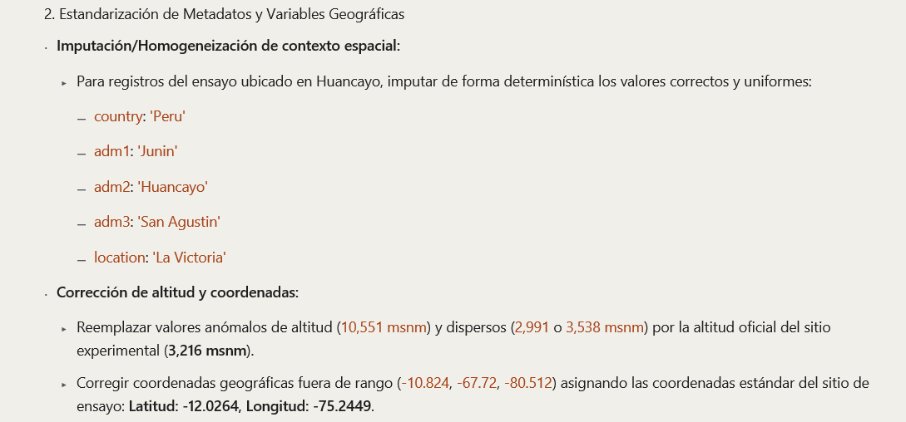{.captura fig-alt="Ejemplo de recomendación de estandarización geográfica"}

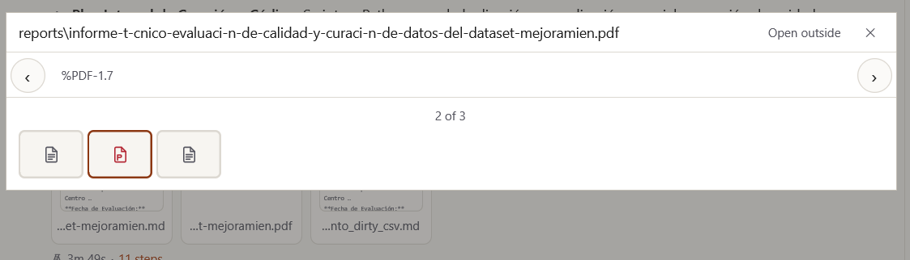{.captura fig-alt="Vista previa del informe generado"}
:::

::: {.column width="49%"}
::: {.prompt-box .numerado .chico-p}
[03]{.num-p} Dame recomendaciones de limpieza y estandarización de datos para cada problema
encontrado.
:::

::: {.prompt-box .numerado .chico-p}
[04]{.num-p} Genera un reporte técnico con el diagnóstico y el plan de limpieza.
:::

::: {.prompt-box .numerado .chico-p}
[05]{.num-p} Procede con la estandarización y limpieza de los datos, siguiendo las
recomendaciones. Guarda el dataset curado como un archivo nuevo y no modifiques el original.
:::

::: {.tarjeta .bien}
[Resultado esperado]{.kicker-t}

- **244** parcelas únicas, sin duplicados
- Ubicación estandarizada: **La Victoria, 3216 msnm**
- Unidades corregidas y variables derivadas recalculadas
- El archivo original **queda intacto**
:::
:::
::::

## Dónde quedan tus archivos

::: {.ruta}
`Documentos › Mini-Me › Taller_Mini-me › (carpeta con código de la conversación)`
:::

:::: {.columns}
::: {.column width="58%"}
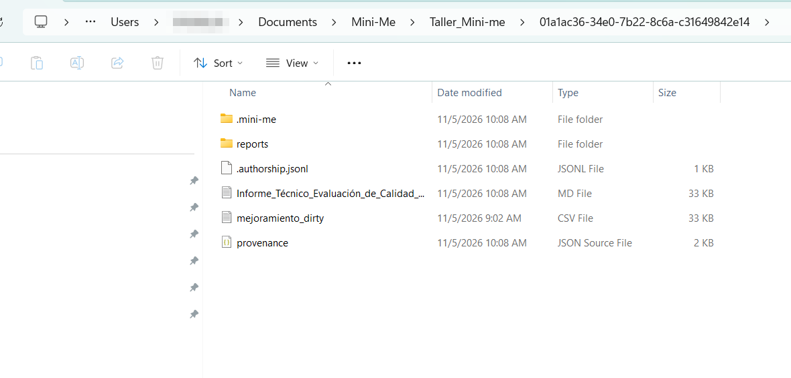{.captura fig-alt="Carpeta de resultados del proyecto"}
:::

::: {.column width="39%"}
::: {.lista-pantalla}
- **mejoramiento_dirty.csv:** copia del original
- **Informe .md y carpeta reports:** informe técnico en PDF
- **provenance.json y .authorship.jsonl:** registro de lo que se hizo (trazabilidad)
:::
:::
::::

## Pasos 06–07 · ¿Qué clon rinde más y qué análisis hacer?

:::: {.columns}
::: {.column width="58%"}
::: {.prompt-box .numerado .chico-p}
[06]{.num-p} Con el dataset curado, propón qué análisis se pueden hacer. ¿Cuál de los clones
evaluados rinde más?
:::

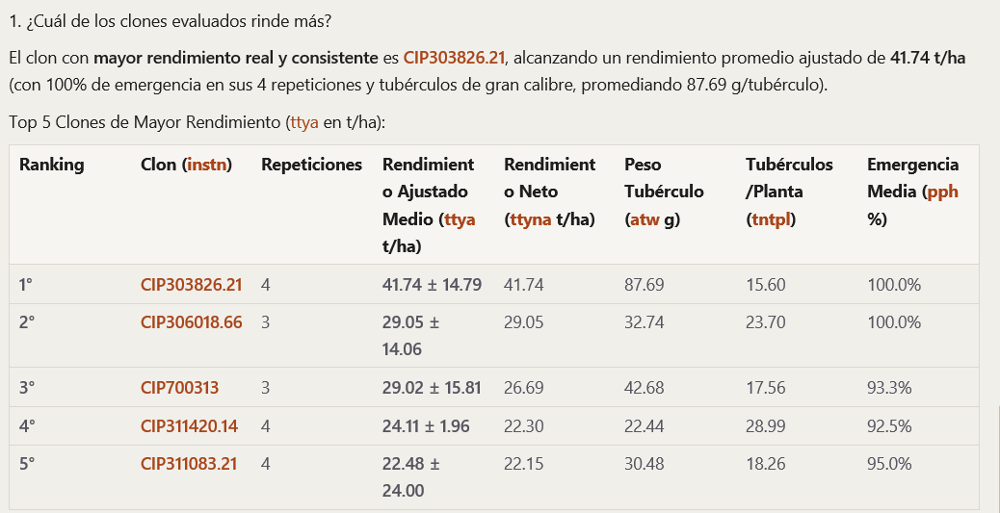{.captura fig-alt="Top 5 clones por rendimiento ajustado"}
:::

::: {.column width="39%"}
::: {.prompt-box .numerado .chico-p}
[07]{.num-p} Dame recomendaciones de análisis estadístico para este ensayo.
:::

::: {.analisis}
[Análisis recomendados (07)]{.kicker-t}

1. **ANOVA y comparación de medias** [hoy hacemos este]{.hoy}
2. Modelos mixtos y BLUPs
3. Correlación y path analysis
4. PCA y clustering
5. Índice de selección multicarácter
:::
:::
::::

## Paso 8 · ANOVA para rendimiento ajustado (ttya)

::: {.prompt-box .numerado .chico-p}
[08]{.num-p} Realiza un ANOVA para ttya con el dataset curado (DBCA): clon (instn) como
tratamiento y repetición (rep) como bloque. Incluye Tukey HSD y un gráfico de los clones con mayor
y menor rendimiento.
:::

:::: {.columns}
::: {.column width="60%"}
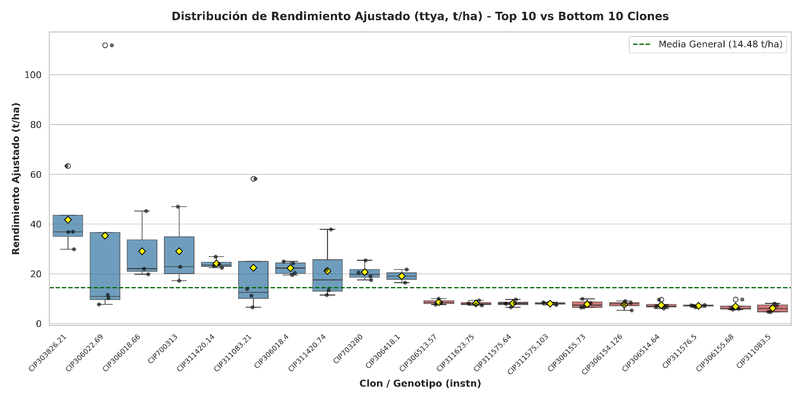{.captura fig-alt="Distribución del rendimiento ajustado, 10 mejores y 10 peores clones"}
:::

::: {.column width="37%"}
::: {.tarjeta}
[Cómo leerlo]{.kicker-t}

- **p (clon) < 0.05:** hay diferencias entre clones
- **p (bloque):** diferencias entre bloques del campo
- **Tukey:** misma letra = no difieren
:::

::: {.tarjeta .alerta}
**Ojo:** una parcela de CIP306022.69 supera 100 t/ha. ¿Es real?
:::
:::
::::

::: notes
Discusión en grupo: ¿coinciden los primeros lugares del ranking (paso 06) y del ANOVA? ¿Cómo
cambiaría el resultado si el valor extremo fuera un error de digitación?
:::

## Búsqueda de bibliografía

::: {.prompt-box .numerado .chico-p}
[01]{.num-p} Búsqueda de bibliografía de rendimiento de papas nativas en Perú, de los últimos 3
años.
:::

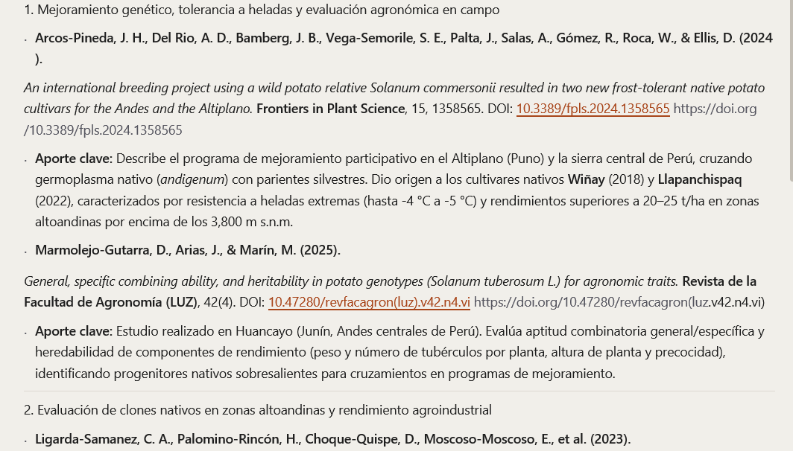{.captura .centrada fig-alt="Resultado de la búsqueda de bibliografía"}

## Generación de teorías

::: {.prompt-box .numerado .chico-p}
[01]{.num-p} Genera hipótesis y la síntesis de teorías mecanísticas a partir de la literatura
científica recopilada.
:::

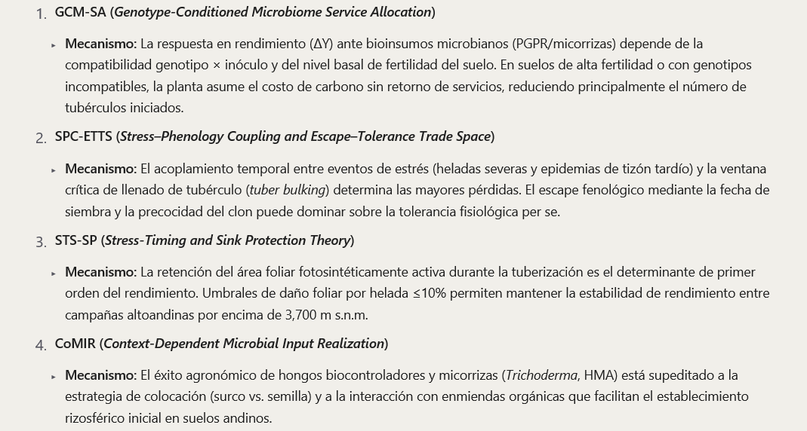{.captura .centrada fig-alt="Teorías mecanísticas generadas a partir de la literatura"}

## Reportes de bibliografía

::: {.prompt-box .numerado .chico-p}
[01]{.num-p} Reporte de la bibliografía de rendimiento de papas nativas en Perú.
:::

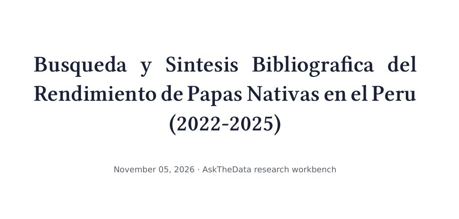{.captura .centrada fig-alt="Portada del reporte de bibliografía generado"}
